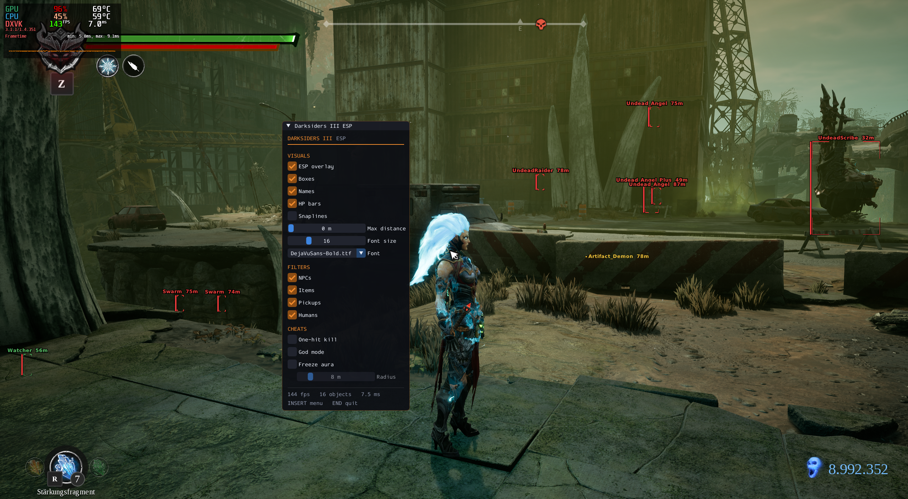
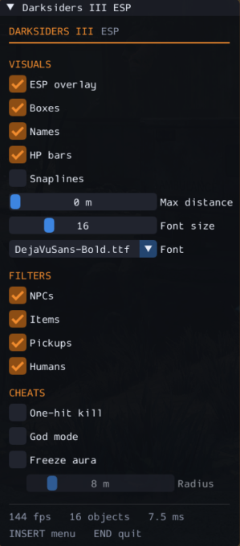

# Darksiders 3 ESP + Cheats

A configurable cross platform Darksiders III ESP powered by [pymew](https://github.com/qb-0/pymew).



## Features

- Box ESP
- Names and distances
- HP bars
- Snaplines
- Live filters for NPCs, items, pickups and humans
- Maximum render distance
- Custom font and font size
- God mode
- One-hit kill
- Freeze aura with adjustable radius
- Ingame ImGui menu

## Installation

- Install Python (64bit)
- Install [pymew](https://github.com/qb-0/pymew):
  ```
  pip install pymew
  ```
- Install `imgui_bundle`:
  ```
  pip install imgui_bundle
  ```

## Instructions

Start Darksiders III in windowed or borderless windowed mode and launch the overlay while the game is running.

### Menu

The ingame menu can be opened by pressing `INSERT`:



### darksiders3.cfg

Startup options are stored in the config file:

```ini
[esp]
exe = Darksiders3-Win64-Shipping.exe
font = DejaVuSans-Bold.ttf
min_box_px = 20
scan_ms = 200
debug = false
fps = 0
exit_key = end
```

| Option | Description |
| --- | --- |
| `exe` | Process name of the game |
| `font` | System font file used for the ESP labels, empty for the default font |
| `min_box_px` | Minimum box height in pixels before an entity is drawn as a dot |
| `scan_ms` | Interval in milliseconds between actor scans |
| `debug` | Show the debug status line |
| `fps` | Overlay refresh rate, `0` uses the monitor refresh rate |
| `exit_key` | Key that closes the overlay |

## Project layout

```
main.py            entry point and overlay loop
ds3esp/
  camera.py        camera reads and world-to-screen projection
  cheats.py        god mode, one-hit kill and freeze aura
  config.py        startup configuration
  entities.py      actor scanner and classification
  esp.py           renderer
  game.py          player, camera and faction context
  menu.py          ImGui menu
  offsets.py       game offsets
  process.py       process wrapper
  structs.py       memory structs
  toggles.py       runtime state
  ue.py            Unreal object, name and class helpers
```